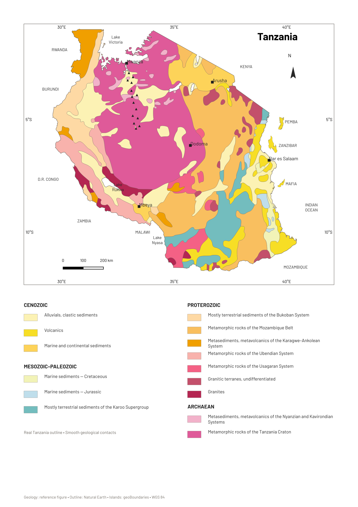

# Geological overview of Tanzania

**Modified after Muhongo (1989) and Pinna et al. (2004)**

An editable QGIS map matching the supplied geological figure's colours, with a real Tanzania mainland outline, smooth geological contacts and detailed island coastlines.

## Downloads

| File | Contents |
| --- | --- |
| [Complete QGIS project](downloads/Tanzania_Geology_Same_Colours.zip) | Ready-to-open QGZ, local GeoPackages, print layouts, styles, Barlow fonts, reference image and source notes |
| [Shapefile collection](downloads/Tanzania_Geology_Shapefiles.zip) | Geological colour classes and real islands, with SHP/SHX/DBF/PRJ/CPG files and matching QML styles |
| [Palette](docs/Reference_palette.csv) | Exact reference legend colours |
| [Project guide](docs/PROJECT_GUIDE.md) | Editing instructions, geometry interpretation, sources and limitations |

The latest project includes the restored **Cretaceous marine-sediment patch southwest of Dar es Salaam** in its pale reference colour.

## Open in QGIS

1. Download the complete project ZIP and extract **everything**.
2. Open `Tanzania_Geology_Same_Colours/Tanzania_Geology_Same_Colours.qgz`.
3. Open **Project → Layouts → Tanzania geology — real outline and smooth contacts**.
4. Install the included Barlow TTF files for matching typography.
5. Keep the `data` folder next to the QGZ file.

All layers are included locally. The project works offline and uses **WGS 84 / EPSG:4326**. QGIS **3.34 or later**, including QGIS 3.40, is supported.

## Map preview

## Included data

- **15 editable multipart geological colour classes**, with the supplied legend colours.
- Real Tanzania mainland outline, coastline and lake edges from Natural Earth.
- **10 detailed island polygons**, including Pemba, Unguja (Zanzibar), Mafia and Lake Victoria islands, from geoBoundaries.
- Town labels, geographic labels, reference-position kimberlite symbols, north arrow and kilometre scale bar.
- A4 print layout and a second layout preserving the original reference figure.
- Optional source GIS, original trace and comparison layers.

For the shapefiles, keep all companion files together. Add `Tanzania_Geology.shp` or `Tanzania_Real_Islands.shp` to QGIS; the accompanying QML files use the correct `MAP_KEY` category field. The full QGIS project retains the richer source attributes and comparison layers.

## Reusable skill

The workflow is saved as **QGIS Reference Map Project**:

[Read the reusable skill](skills/qgis-reference-map-project/SKILL.md)

It covers reference-colour matching, real geographic outlines, shared-border smoothing, protection of small patches, GeoPackage packaging and project portability checks. Its bundled scripts can package a project safely and audit the archive after extraction elsewhere.

## Validation

The final project was checked after extraction into a separate directory:

- All **20 layers** resolve locally.
- All **15 main geological classes** have valid geometry.
- The Cretaceous class has **four parts**, including the restored Dar es Salaam patch.
- Main geological coverage has no material gaps or overlaps.
- The named print layout renders with the included fonts.
- GeoPackages and archives pass integrity checks.

See [validation details](docs/validation.json), [package audit](docs/package_audit.json) and [file checksums](CHECKSUMS.sha256). The project archive also includes `package_checksums.json`.

## Sources and interpretation

**Geological appearance:** the user-supplied figure captioned *Geological overview of Tanzania (modified after Muhongo, 1989, and Pinna et al., 2004)*. Internal geological contacts are an image-derived cartographic interpretation, approximately registered to the printed graticule. This is a national overview, not a new geological survey.

**Mainland outline and lakes:** [Natural Earth](https://www.naturalearthdata.com/), 1:10 million country and lake vectors, public domain. Geological fills were clipped to the real land outline; small edge gaps were assigned the nearest reference class.

**Real islands:** [geoBoundaries gbOpen TZA ADM0](https://www.geoboundaries.org/api/current/gbOpen/TZA/ADM0/), year represented **2021**, boundary ID **TZA-ADM0-36199320**, source **Sentinel-2 10-Meter Land Use/LandCover**, [CC BY 4.0](https://creativecommons.org/licenses/by/4.0/). Island geometry remains detailed. Reference-led island fills do not establish geological survey accuracy.

**Optional source geology:** [Heed725/Tanzania_Geology_Shapefile](https://github.com/Heed725/Tanzania_Geology_Shapefile). Original source attributes, attribution and educational/research-use terms are retained in the guide.

**Optional active faults:** [GEM Global Active Faults Database](https://github.com/GEMScienceTools/gem-global-active-faults), CC BY-SA 4.0; see the included GEM licence. These are separate from the old figure's schematic linework.

**Fonts:** Barlow, SIL Open Font License; see the included `fonts/OFL.txt`.

Underlying datasets and the supplied reference image retain their separate rights and terms. This repository does not claim ownership of the original geological publication.

Maintained by **Hemed Lungo / Heed725**.

